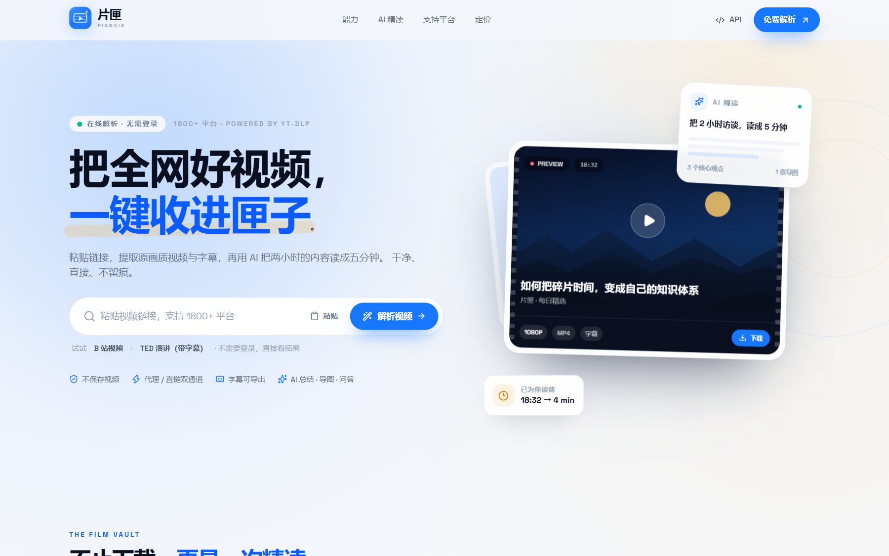
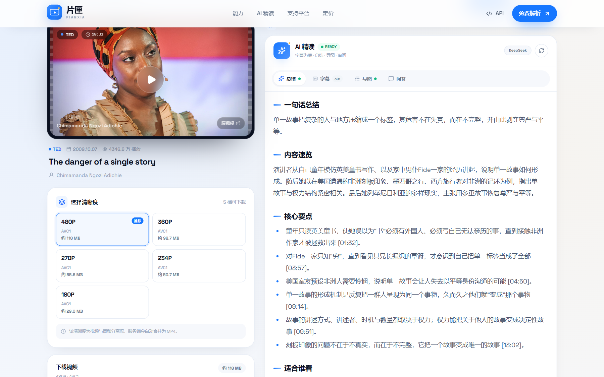
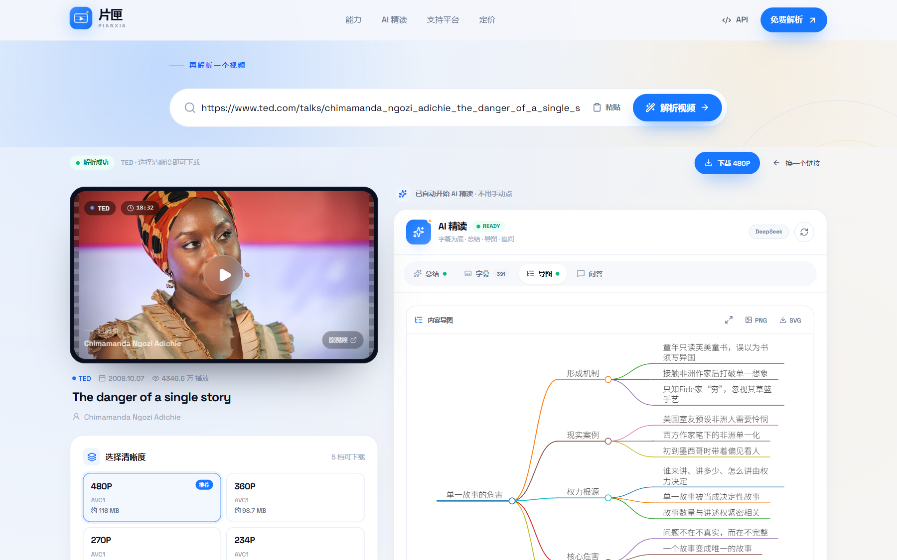
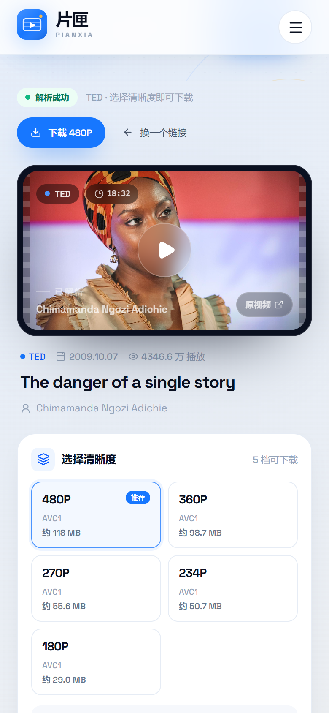
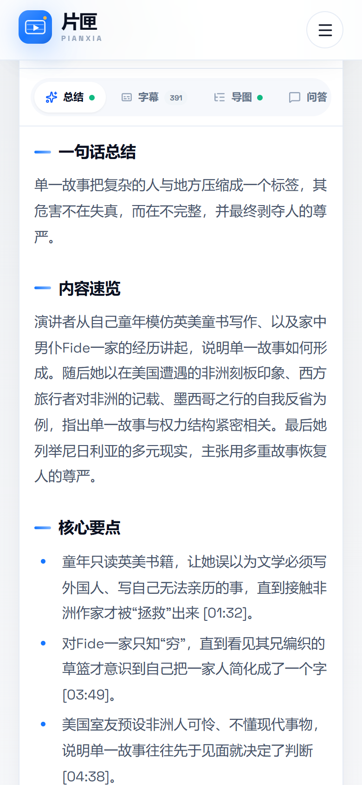
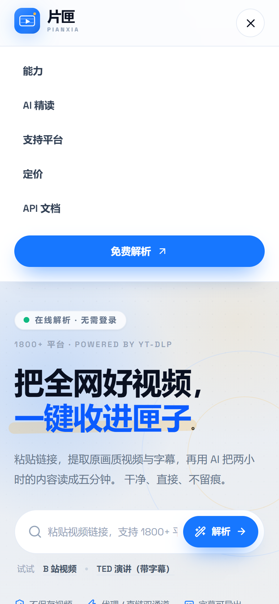
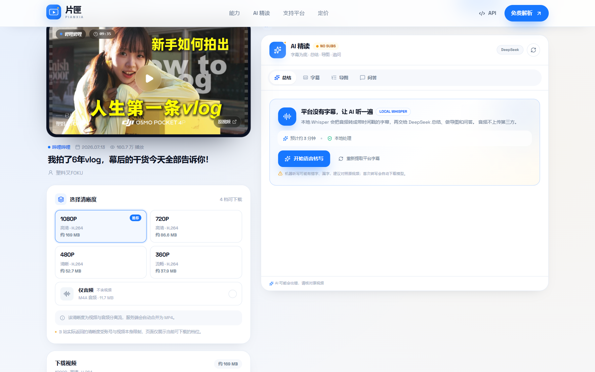
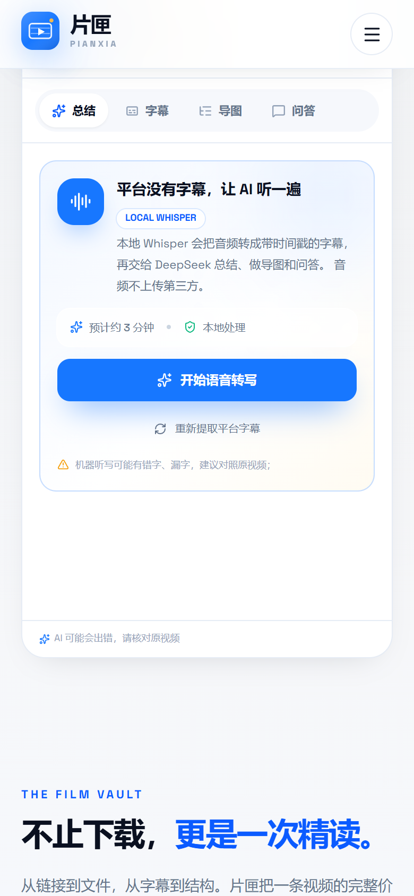
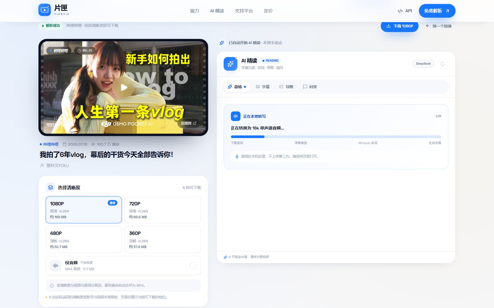
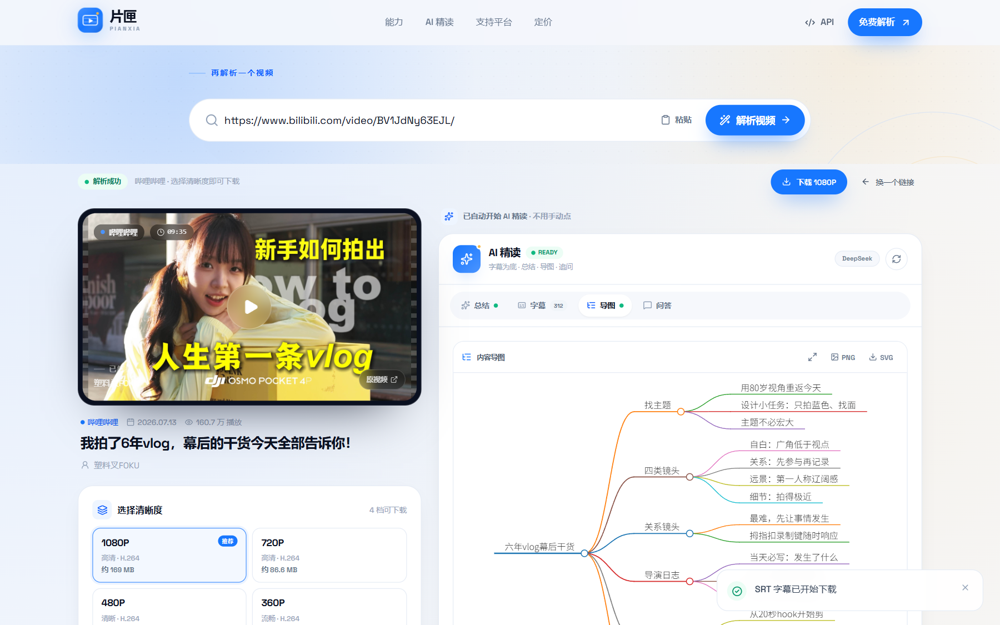

# 片匣 PIANXIA · 验收报告

- 日期：2026-11-20
- 版本：1.1.0
- 环境：Windows 11 / Python 3.12.10 / Node 24.21.0 / Chromium 1440×900 + 390×844
- 访问：`http://127.0.0.1:8000`（生产构建由 FastAPI 同源托管）
- 原始需求：`docs/需求分析.md`
- 确认方案：`docs/方案评审.md`

## 1. 交付内容

| 模块 | 实现 |
|---|---|
| 解析 | yt-dlp + B 站公开 API 适配；统一返回标题、封面、时长、UP 主、格式、字幕语言 |
| 下载 | 任务制 + 进度轮询 + 文件流；代理优先；单文件直链按钮 |
| B 站 | buvid 引导、WBI 签名、DASH 音视频下载、ffmpeg 合并、CC 字幕读取 |
| 字幕 | TED HLS 字幕分片合并、VTT/SRT/JSON3 解析、SRT/VTT/TXT 导出 |
| 无字幕兜底 | 本地 faster-whisper small + ModelScope；手动触发、SSE 进度、来源标记、音频不上传 |
| AI | DeepSeek SSE：结构化总结、思维导图、基于字幕的追问 |
| 导图 | markmap 交互、全屏、SVG、4K PNG |
| UI | 片匣电影感工作台：非对称 Hero、深色放映卡、能力 Bento、平台墙、定价占位、移动端 |
| 工程 | 无数据库、临时文件 TTL、SSRF 基础防护、DOMPurify、17 项单测、一键启动 |

## 2. 实测结果

### 2.1 真实 AI（DeepSeek）

| 项 | 结果 |
|---|---|
| 模型 | `deepseek-chat` |
| 输入 | TED 演讲，391 条 `zh-cn` 人工字幕 |
| 总结 | 成功，710 字，含 `[01:32]` 等时间戳 |
| 导图 | 成功，344 字 Markdown，前端渲染 22 个节点 |
| 问答 | 成功，56 字，引用 `[13:57][17:24]` |
| 端到端耗时 | 约 20.3 秒（字幕已缓存时） |
| 结论 | 真实 Key 联调通过，未使用假数据兜底 |

### 2.2 下载与字幕

| 项 | 结果 |
|---|---|
| B 站匿名 | `BV1GJ411x7h7` 成功；480P / 360P + 音频 |
| B 站登录态 | 配置 `BILIBILI_SESSDATA` 后：1080P / 720P / 480P / 360P；12 种字幕语言；`bilibili_logged_in=true` |
| B 站 CC → AI | 44 条 CC 字幕 → 517 字总结、347 字导图；耗时 6.1 秒，无错误 |
| B 站下载 | 360P 文件 14,767,133 字节；ffmpeg 合并；浏览器端下载成功 |
| B 站仅音频 | 修复此前误下完整视频的问题；现在输出 11,816,766 字节 `.m4a` |
| TED 字幕 | 391 条；HLS m3u8 分片并发合并约 10 秒 |
| SRT 导出 | 30,481 字节；`HH:MM:SS,mmm` 标准时间戳 |
| 通用直链 | `samplelib.com` 单文件直链校验通过；`w3schools` 受防盗链影响，已提示改用代理 |

### 2.3 无字幕 ASR（新增）

| 项 | 结果 |
|---|---|
| 样本 | `BV1JdNy63EJL`，9:35，平台无任何字幕 |
| 模型 | `Systran/faster-whisper-small`，486MB，ModelScope 下载 |
| 本地转写 | 312 条字幕，5865 字；自动识别中文 |
| 字幕来源 | `本地 Whisper 转写（small）`；界面显示机器转写警告 |
| 端到端 | 123.6 秒（下载音频 + 本地转写 + DeepSeek 总结 / 导图） |
| 总结 / 导图 | 900 字 / 372 字；导图 25 个节点 |
| 字幕导出 | SRT 19,954 字节，时间戳标准 |
| 无 ASR 对照 | `BV1Hw4m1i7yu` 直接使用 B 站 `ai-zh`（259 条），672 字总结，未触发 ASR |
| 回归 | TED 391 条人工字幕，18.0 秒完成总结，未受影响 |

### 2.4 导图与 UI

| 项 | 结果 |
|---|---|
| 导图全屏 | 原生 Fullscreen API，进入/退出正常 |
| PNG | 3840×2528，649KB |
| SVG | 12,260 字节，含内联样式与背景 |
| 桌面 UI | 1440×900，无控制台错误；格式切换、下载快捷键、四个 Tab 可用 |
| 移动 UI | 390×844，无横向滚动；菜单、格式、下载、AI 面板可用 |
| 生产模式 | `vite build` 后 FastAPI 同源托管，TED 解析 + 真实 AI 全流程通过 |
| 一键启动 | `start.ps1` 从干净 `.venv` 安装依赖并启动成功；`ai=True` |

### 2.5 自动化测试

```bash
./.venv/Scripts/python.exe -m pytest backend/tests -q
# 23 passed
```

覆盖：URL 提取、私网/回环拦截、文件名、VTT/SRT/B 站 JSON/JSON3 解析、语言选择、字幕截断、格式与大小估算、SSE 换行编码、B 站字幕优先级、B 站仅音频选择、ASR 元数据与超时长保护。

## 3. 视觉验收

### 首页（1440）



### 真实 DeepSeek 总结



### 真实 AI 导图



### 移动端下载



### 移动端 AI 总结



### 移动端菜单



### 无字幕兜底入口



### 移动端语音转写入口



### 本地 Whisper 转写进度



### ASR 字幕与导出


### 真实 ASR + DeepSeek 总结


### ASR 转写后的导图



## 4. 复现方式

```powershell
# 1. 配置 Key
Copy-Item backend\.env.example backend\.env
# 编辑 backend\.env，填入 DEEPSEEK_API_KEY

# 2. 一键启动
.\start.ps1

# 3. 打开
# http://127.0.0.1:8000
```

或按 README 分别启动后端与 Vite 开发服务器。

## 5. 已知限制

- 本机 YouTube 网络不可达；代码支持但未做真实链路验证。
- Vimeo 未登录时平台拒绝解析。
- B 站匿名通常最高 480P；本项目已配置登录 Cookie，当前登录态可看 1080P 与 CC / AI 字幕。Cookie 过期后会退回匿名。番剧 / 课程未适配。
- 直链受平台防盗链影响，失败时请使用代理下载。
- 本地 Whisper 首次下载约 486MB 模型；9:35 视频约 2 分钟，60 分钟视频可能约 10 分钟；机器转写有少量同音字/专有名词错误。
- `ASR_MAX_DURATION_MIN` 默认 60 分钟，超长视频直接拒绝本地转写。
- 批量下载、用户系统、支付为后续规划；当前定价区为占位，不收费。
- 4K PNG 在低配设备上可能占用较高内存（本次 3840×2528 正常）。

## 6. 验收结论

P0（解析、下载、多平台）+ P1（AI 总结、字幕、导图、问答、移动端、无字幕本地 Whisper 兜底）+ 营销/定价占位均已交付。真实 DeepSeek、真实 B 站下载、B 站 AI 字幕、TED 字幕、无字幕 ASR、SRT 与 4K 导出均完成验证。YouTube 与 B 站部分内容受本机网络 / 登录态限制，已在 README 和本报告中如实标注。
